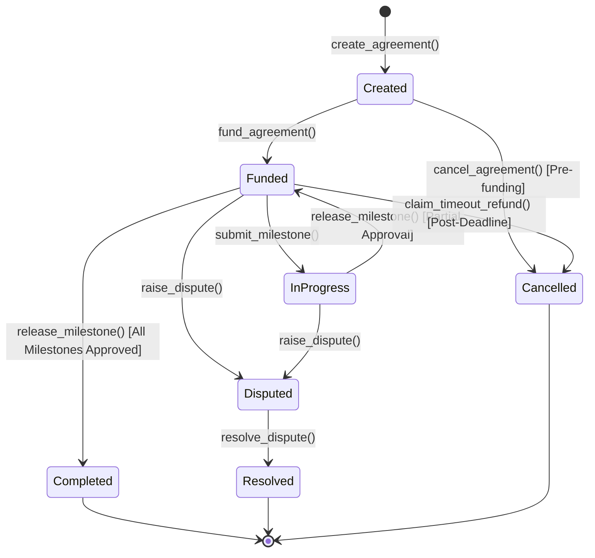

# StrataFlow Contracts 📜

[](LICENSE)
[](https://stellar.org)
[](https://github.com/StrataFlow-Org/strataflow-contracts/actions)

> **Part of the [StrataFlow Protocol](https://github.com/StrataFlow-Org) suite.**  
> Trustless milestone escrows and programmable settlement on the Stellar network. Built for Stellar Drips Wave.

---

## 🌟 Overview

`strataflow-contracts` contains the Soroban smart contract logic powering the StrataFlow protocol. It provides non-custodial milestone-based escrow contracts where clients lock Stellar Asset Contract (SAC) tokens (such as USDC or native XLM), service providers submit completion evidence on-chain or via IPFS hashes, and clients release payments upon milestone verification.

In the event of disagreement, a neutral third-party arbiter can resolve disputes by apportioning remaining balances on-chain.

---

## 🛡️ Security Architecture & Invariants

1. **Persistent Storage with Automatic TTL Extension**: Dynamic agreement vectors are partitioned into `storage().persistent()` entries rather than instance storage, ensuring contract size never approaches Soroban 64KB limits.
2. **Capital Trapping Remediation (`claim_timeout_refund`)**: If a designated provider fails to deliver milestones before the deadline, the client can reclaim 100% of remaining escrowed funds.
3. **Emergency Circuit Breaker (`set_pause` / `is_paused`)**: Contract administrator can pause deposits and state changes in the event of an upstream or network anomaly.
4. **Checks-Effects-Interactions (CEI)**: State mutations and balance decrements occur strictly prior to token transfer invocations.
5. **Exact Dispute Apportionment**: Arbiters must apportion the exact remaining balance (`client_amount + provider_amount == balance`), preventing residual capital freeze.
6. **Protocol Fee Ceiling**: Admin fees are capped at a strict maximum of 500 basis points (5%), protecting users against fee gouging.

---

## 🏗️ State Machine



---

## ⚡ Contract Interface

| Function | Access | Description |
| :--- | :--- | :--- |
| `initialize(admin)` | Admin | Initializes protocol admin and counters. |
| `create_agreement(...)` | Client | Creates a new escrow agreement with milestones. |
| `fund_agreement(id, funder)` | Funder / Client | Transfers required SAC tokens to contract storage. |
| `submit_milestone(id, idx, proof)`| Provider | Submits IPFS deliverable proof for verification. |
| `release_milestone(id, idx)` | Client | Releases milestone payout minus protocol fee. |
| `claim_timeout_refund(id)` | Client | Refunds remaining balance if deadline has passed. |
| `raise_dispute(id, idx, caller)` | Client / Provider | Freezes remaining balance into dispute status. |
| `resolve_dispute(id, client, provider)`| Arbiter | Distributes contested balance between parties. |
| `cancel_agreement(id)` | Client | Cancels an unfunded draft agreement. |
| `set_pause(paused)` | Admin | Triggers emergency pause circuit breaker. |
| `set_fee_config(fee_bps, recipient)` | Admin | Updates protocol fee (capped at 500 bps / 5%). |
| `get_agreement(id)` | Public Read | Queries agreement details and milestone progress. |
| `get_contract_version()` | Public Read | Returns semver tuple `(major, minor, patch)`. |

---

## 🧪 Local Testing

Compile the test harness and execute unit tests:

```bash
cargo test
```

Execute Clippy linter:

```bash
cargo clippy --all-targets -- -A dead_code
```

Build the optimized Wasm binary:

```bash
cargo rustc --target wasm32-unknown-unknown --release --crate-type cdylib
```

---

## 📄 License

This repository is licensed under the [MIT License](LICENSE).
