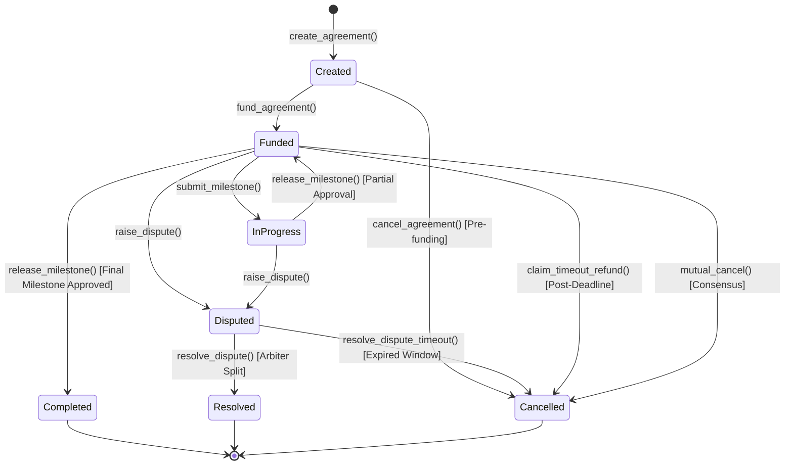

# StrataFlow Contracts 📜

[](https://stellar.org)
[](https://soroban.stellar.org)
[](https://www.rust-lang.org)
[](https://rust-lang.github.io/rust-clippy/)
[](https://github.com/StrataFlow-Org/strataflow-contracts)
[](LICENSE)
[](https://github.com/StrataFlow-Org/strataflow-contracts/actions)

> **Autonomous Milestone Escrow Smart Contracts on Stellar & Soroban.**  
> Enforces programmable milestone releases, non-custodial capital locking, cryptographic evidence submission, dispute resolution, and automated timeout refunds.

---

## 🌟 Executive Overview

`strataflow-contracts` implements the on-chain smart contract protocol of StrataFlow using **Soroban**, Stellar's smart contract platform. It provides decentralized, non-custodial milestone escrows for Stellar Asset Contract (SAC) tokens—including native **XLM** and Circle **USDC**.

Clients lock funds in the contract, service providers submit cryptographic deliverable proofs (IPFS CIDs), clients approve milestones to trigger immediate token releases, and designated arbiters apportion remaining funds in the event of dispute.

```
                           +------------------------+
                           |     CLIENT WALLET      |
                           +-----------+------------+
                                       |
                 1. create_agreement() | 2. fund_agreement() [SAC Tokens]
                                       v
+---------------------------------------------------------------------------------------+
|                               STRATAFLOW SOROBAN ESCROW                               |
|                                                                                       |
|   +-------------------+    +--------------------+    +----------------------------+   |
|   |  STATE MACHINE    |    |  CHECKS-EFFECTS    |    |      STORAGE & TTL         |   |
|   |                   |    |  INTERACTIONS      |    |                            |   |
|   | - Created         |    |                    |    | - storage().persistent()   |   |
|   | - Funded          |    | - Verify Caller    |    | - Automatic TTL Bumping    |   |
|   | - InProgress      |    | - Decrement State  |    | - Bounded Vectors          |   |
|   | - Completed       |    | - Transfer Tokens  |    | - Zero Instance Bloat      |   |
|   | - Disputed        |    | - Protocol Fee Cut |    |                            |   |
|   | - Resolved        |    +--------------------+    +----------------------------+   |
|   +---------+---------+                                                               |
+-------------|-------------------------------------------------------------------------+
              |
              | 3. submit_milestone(proof_hash) [Provider]
              | 4. release_milestone(idx) [Client] OR raise_dispute() [Client/Provider]
              | 5. resolve_dispute(split) [Arbiter] OR claim_timeout_refund() [Client]
              v
+-----------------------------+               +-----------------------------+
|      PROVIDER WALLET        |               |       ARBITER WALLET        |
|  (Receives Milestone Funds) |               |  (Resolves Contested Split) |
+-----------------------------+               +-----------------------------+
```

---

## 🚀 Live Stellar Testnet Deployment Details

The contract is compiled, deployed, initialized, and operational on Stellar Testnet:

| Parameter | Configuration | Verifiable Stellar Explorer Link |
|---|---|---|
| **Contract ID** | `CDXVD3AA43SE2D52ZBJSH3RDKAPOYG6OCDAZGSQD6M5TCBQIG3HTLY6J` | [Explore Contract on StellarExpert](https://stellar.expert/explorer/testnet/contract/CDXVD3AA43SE2D52ZBJSH3RDKAPOYG6OCDAZGSQD6M5TCBQIG3HTLY6J) |
| **Network** | Stellar Testnet (`Test SDF Network ; September 2015`) | [Network RPC Status](https://soroban-testnet.stellar.org) |
| **Protocol Admin** | `GBWFZHBYEKF5MR2MHW7JAZX6ZRI2PKKBL6IALEMJSBMU4JMDSIB34KP5` | [Explore Admin on StellarExpert](https://stellar.expert/explorer/testnet/account/GBWFZHBYEKF5MR2MHW7JAZX6ZRI2PKKBL6IALEMJSBMU4JMDSIB34KP5) |
| **WASM Hash** | `3cf260524d911a16c0012bf650f5d1453793ddf4362710d602e869956e5147fb` | [Verified Bytecode on StellarExpert](https://stellar.expert/explorer/testnet/contract/CDXVD3AA43SE2D52ZBJSH3RDKAPOYG6OCDAZGSQD6M5TCBQIG3HTLY6J) |
| **Contract Version** | `1.0.0` | SemVer metadata verified on-chain |
| **Circuit Breaker** | `Active (Unpaused)` | Emergency circuit breaker operational |
| **Deployment Tx** | `25bf399a52be5f942e9f62c965f0e8d6a0800db0673f79d779bc79f3b4378988` | [Deployment Transaction](https://stellar.expert/explorer/testnet/tx/25bf399a52be5f942e9f62c965f0e8d6a0800db0673f79d779bc79f3b4378988) |
| **Initialization Tx** | `cf2cfe25015e36bd7740f4fc9d13947d2425bbd83be23c88b574e7b8eae1b6ee` | [Initialization Transaction](https://stellar.expert/explorer/testnet/tx/cf2cfe25015e36bd7740f4fc9d13947d2425bbd83be23c88b574e7b8eae1b6ee) |
| **Stellar Lab** | Inspect live contract interface | [Inspect in Stellar Lab](https://lab.stellar.org/r/testnet/contract/CDXVD3AA43SE2D52ZBJSH3RDKAPOYG6OCDAZGSQD6M5TCBQIG3HTLY6J) |

---

## 🛡️ Protocol Invariants & Formal Safety Guarantees

1. **Exact Capital Conservation**:
   - `total_released + remaining_balance == total_funded` holds across all agreement operations.
   - Arbiters cannot synthesize or trap capital: `client_split + provider_split == remaining_balance` is strictly enforced upon dispute resolution.
2. **Checks-Effects-Interactions (CEI)**:
   - State transitions and balance decrements occur strictly prior to calling external SAC token `transfer` invocations, defending against reentrancy vectors.
3. **Participant Anti-Collusion**:
   - The contract rejects any agreement where `client == provider`, `client == arbiter`, or `provider == arbiter`.
4. **Two-Step Ownership Transfer**:
   - Administrative transfer requires explicit two-step execution (`nominate_admin` followed by `accept_admin` from the nominee), eliminating accidental loss of admin rights through typographical errors.
5. **Anti-Freeze Fallback (`resolve_dispute_timeout`)**:
   - If an arbiter fails to resolve a dispute within the dispute window (default 7 days / 100,800 ledgers), participants can reclaim funds, preventing permanent escrow freezing.
6. **Persistent Storage Partitioning & TTL Bumping**:
   - Agreement records are partitioned into `storage().persistent()` entries rather than instance storage, keeping storage footprint bounded and triggering Soroban TTL extensions on every state transition.
7. **Protocol Fee Ceiling**:
   - Admin protocol fees are strictly capped at 500 basis points (5.00%), protecting participants against arbitrary fee inflation.

---

## 🏗️ State Machine



---

## ⚡ Complete Contract Interface (20 Methods)

| Function | Access | Description |
| :--- | :--- | :--- |
| `initialize(admin)` | Admin | Initializes protocol admin, counters, and version metadata. |
| `create_agreement(...)` | Client | Creates a new milestone escrow agreement with validation. |
| `fund_agreement(id, funder)` | Funder / Client | Locks designated SAC token amount into contract custody. |
| `submit_milestone(id, idx, proof)`| Provider | Submits IPFS deliverable CID for client verification. |
| `reject_milestone(id, idx, feedback)`| Client | Rejects submitted milestone with feedback hash. |
| `release_milestone(id, idx)` | Client | Releases milestone payout minus protocol fee to provider. |
| `claim_timeout_refund(id)` | Client | Refunds 100% of remaining balance if deadline has expired. |
| `raise_dispute(id, idx, caller)` | Client / Provider | Freezes remaining balance and transitions state to Disputed. |
| `resolve_dispute(id, client, provider)`| Arbiter | Apportions remaining balance between client and provider. |
| `resolve_dispute_timeout(id)` | Client / Provider | Fallback claim if arbiter is unresponsive beyond dispute window. |
| `cancel_agreement(id)` | Client | Cancels an unfunded draft agreement. |
| `mutual_cancel(id, caller)` | Client / Provider | Bilateral agreement cancellation and escrow refund. |
| `reassign_arbiter(id, new_arbiter)`| Admin | Reassigns arbiter if designated party becomes unavailable. |
| `set_pause(paused)` | Admin | Emergency circuit breaker toggling deposit acceptance. |
| `set_fee_config(fee_bps, recipient)` | Admin | Updates protocol fee (capped at 500 bps / 5%). |
| `nominate_admin(new_admin)` | Admin | Step 1 of two-step admin ownership transfer. |
| `accept_admin()` | Nominee | Step 2 of two-step admin ownership transfer. |
| `get_agreement(id)` | Public Read | Queries agreement details, party roles, and milestone statuses. |
| `get_contract_version()` | Public Read | Returns semver tuple `(major, minor, patch)`. |
| `get_protocol_metrics()` | Public Read | Returns aggregate protocol volume and escrow counts. |

---

## 🧪 Local Testing & Verification (37 Tests Passing)

Execute the comprehensive test suite with property tests and invariant verifications:

```bash
cargo test
```

Execute Clippy linter with strict zero-warning enforcement:

```bash
cargo clippy --all-targets -- -D warnings
```

Compile the optimized Wasm binary for deployment:

```bash
cargo rustc --target wasm32-unknown-unknown --release --crate-type cdylib
```

---

## 📄 License & Governance

- **License**: Licensed under the [MIT License](LICENSE).
- **Security Policy**: See [SECURITY.md](SECURITY.md) for responsible disclosure procedures.
- **Contributing**: Read [CONTRIBUTING.md](CONTRIBUTING.md) for developer guidelines.
- **Code of Conduct**: Governed by the [Contributor Covenant](CODE_OF_CONDUCT.md).
- **Changelog**: Detailed release history in [CHANGELOG.md](CHANGELOG.md).
