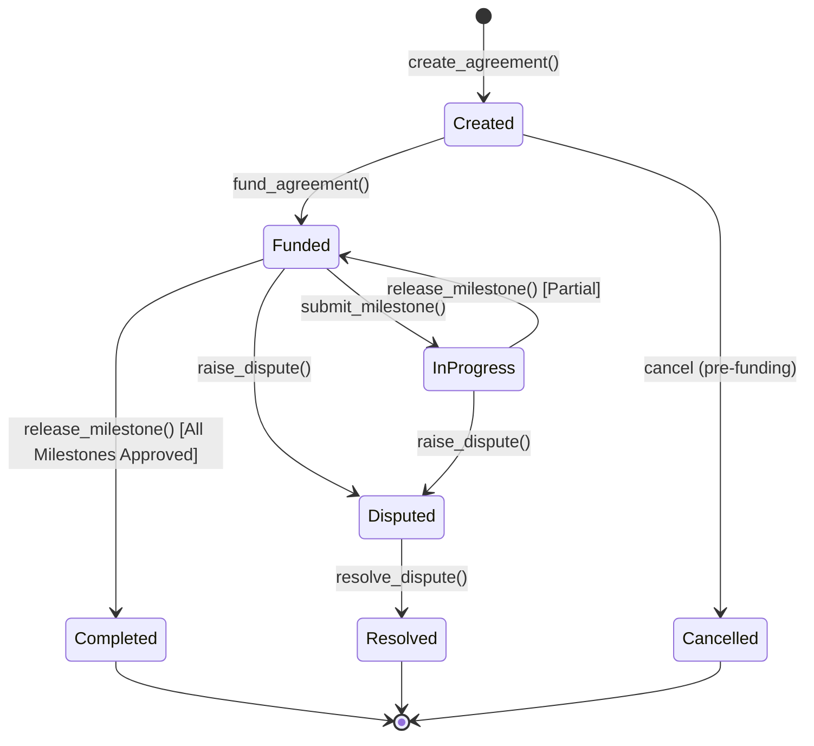

# StrataFlow Contracts 📜

[](LICENSE)
[](https://stellar.org)
[](https://github.com/winningtalker-commits/strataflow-contracts/actions)

> **Part of the [StrataFlow Protocol](https://github.com/winningtalker-commits) suite.**  
> Trustless milestone escrows and programmable settlement on the Stellar network.

---

## 🌟 Overview

`strataflow-contracts` contains the Soroban smart contract logic powering the StrataFlow protocol. It provides non-custodial milestone-based escrow contracts where clients lock Stellar Asset Contract (SAC) tokens (such as USDC or native XLM), service providers submit completion evidence on-chain or via IPFS hashes, and clients release payments upon milestone verification.

In the event of disagreement, a neutral third-party arbiter can resolve disputes by apportioning remaining balances on-chain.

---

## 🏗️ State Machine



---

## ⚡ Contract Interface

| Function | Access | Description |
| :--- | :--- | :--- |
| `initialize(admin)` | Admin | Initializes protocol admin and counters. |
| `create_agreement(...)` | Client | Creates a new escrow agreement with milestones. |
| `fund_agreement(id, funder)` | Funder / Client | Transfers required SAC tokens to contract storage. |
| `submit_milestone(id, idx, proof)`| Provider | Submits IPFS deliverable proof for verification. |
| `release_milestone(id, idx)` | Client | Releases milestone payout to provider. |
| `raise_dispute(id, idx, caller)` | Client / Provider | Freezes remaining balance into dispute status. |
| `resolve_dispute(id, client, provider)`| Arbiter | Distributes contested balance between parties. |
| `get_agreement(id)` | Public Read | Queries agreement details and milestone progress. |
| `get_counter()` | Public Read | Returns total agreements created. |

---

## 🧪 Local Testing

Compile the test harness and execute unit tests:

```bash
cargo test
```

Build the optimized Wasm binary:

```bash
cargo build --target wasm32-unknown-unknown --release
```

---

## 🌐 Deployed Networks

| Network | Contract ID | RPC Endpoint |
| :--- | :--- | :--- |
| **Stellar Testnet** | *Pending Wave Deployment* | `https://soroban-testnet.stellar.org` |
| **Stellar Mainnet** | *Coming Soon* | `https://mainnet.sorobanrpc.com` |

---

## 📄 License

This repository is licensed under the [MIT License](LICENSE).

